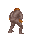

# xcom-editor

[](https://github.com/redtoad/xcom-editor/actions/workflows/go.yml)

This is a library to load image resources for the game [UFO: Enemy Unknown](https://en.wikipedia.org/wiki/UFO:_Enemy_Unknown). 

## Game images

All images are stored in a custom format (see https://www.ufopaedia.org/index.php/Image_Formats for more information).

Here is an example how you can extract the images from `ZOMBIE.PCK` to create an animated GIF:

```go
package main

import (
    "image/gif"
    "os"
    
    "github.com/redtoad/xcom-editor/resources"
)

func main() {
    // load all game palettes 
    palettes, _ := resources.LoadPalettes("GEODATA/PALETTES.DAT")

    // load image data from .PCK (all offsets are stored in .TAB file)
    offsets, _ := resources.LoadTAB("UNITS/ZOMBIE.TAB", 2)
    collection, _ := resources.LoadImageCollectionFromPCK("UNITS/ZOMBIE.PCK", 32, offsets)
    
    // convert to animated gif
    animated := collection.Animated(25, 40, palettes[4])
    f, _ := os.Create("zombie.gif")
    _ = gif.EncodeAll(f, animated)
}
```

The result is:




## Savegames

The `savegame` package loads and saves savegames (`GAME_1` ... `GAME_10`). All 27
Geoscape data files are supported, as well as the 14 additional Battlescape files of
savegames saved during a mission (available as `Savegame.Battle`). Every file is
written back byte-identical to the original. See [`internal/geoscape`](internal/geoscape)
and [`internal/battlescape`](internal/battlescape) for the file formats.

```go
sg, _ := savegame.Load("GAME/GAME_1")
sg.Countries.Countries[0].Satisfaction = 3 // make the USA happy
_ = sg.Save()
```

The real savegames in `testdata/` are used for round-trip tests.

## Savegame editor

`cmd/savegame-editor` is a web-based editor for savegames:

```sh
go run ./cmd/savegame-editor path/to/game/root   # folder containing GAME_1 ... GAME_10
```

It shows whether a savegame was saved during a mission (with turn, surviving
units and score) and has a map of both hemispheres of the globe with all
bases, X-COM craft and UFOs, their flight paths and details on hover. The
frontend (Svelte) is in `cmd/savegame-editor/frontend`; run `npm run build`
there after changing it, the build output is embedded into the binary.
